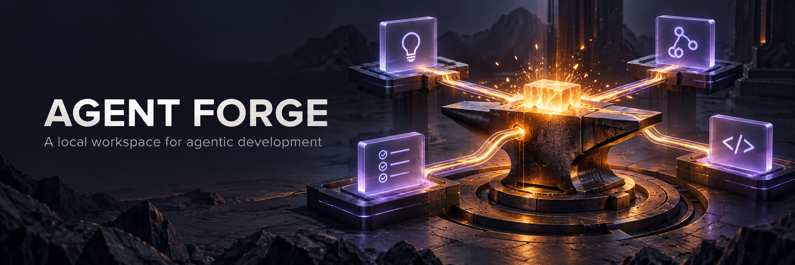

# Agent Forge Harness



Agent Forge Harness gives coding agents and their operators a shared workflow for choosing work, checking changes and handing off results. This repository contains the headless engine, command-line tools, Claude Code workflows, hooks, skills, Hearth service and browser dashboard. You can use it on its own or coordinate several repositories from one checkout. [Harness guide](docs/HARNESS-GUIDE.md)

Agent Forge Desktop adds a Windows interface for projects, Beads, Keeper briefs, sessions, runs and reviews. It uses an exact revision of this engine. Desktop owns the native shell, app tests, build and releases. The illustration above is generated artwork. [Agent Forge Desktop](https://github.com/jupes/agent-forge-desktop) · [Artwork provenance](docs/images/agent-forge-banner.md)

## Get started

Install Git and Bun 1.4.2. Clone the harness and install its locked dependencies, which include TypeScript.

```sh
git clone https://github.com/jupes/agent-forge-harness.git
cd agent-forge-harness
bun install --frozen-lockfile
bun run typecheck
```

Open Claude Code in the repository root to load its commands, agents and hooks. Use `/go` for a scoped task or `/forgemaster` for a guided research, plan, implement and ship workflow. The optional `bun run setup` wizard configures local preferences. Use `gh auth login` when you need GitHub CLI operations such as opening a pull request.

Install Beads (`bd`) for live issue tracking. Run `bd doctor` to check your local setup. Keep the Beads database, exports, credentials and machine-specific configuration out of Git. This project keeps its tracker local. [Agent conventions](CLAUDE.md) · [Repository content rules](docs/REPOSITORY-CONTENT.md)

## Use the browser dashboard

```sh
bun run dashboard
```

The command starts the local dashboard and starts or attaches to Hearth. Open the short-lived authenticated launch link printed in the terminal. Use the address as printed. To open another window while the dashboard is running, run `bun run dashboard:open` for a fresh link.

Use the dashboard to inspect the Beads graph, follow runs and open Council reviews. Council can review a pull request, plan, issue or text. Its default profile uses deterministic fake agents so you can try a review without provider credentials. For a multi-provider review, choose an appropriate profile, configure its credentials locally and review the roster, source and budget before convening it. [Council profiles and review instructions](docs/COUNCIL-REVIEWS.md)

## Work across repositories

1. Copy the example to a local `repos/repos.json`. For each repository, add an object to the `repos` array with its `name`, clone `url` and verified `defaultBranch`. The `/add-repo` workflow can register a repository for you. [Configuration example](repos/repos.json.example) · [Registration instructions](.claude/commands/add-repo.md)
2. Run `bun run repo init --human` to clone registered repositories. Use `/sync-knowledge` in Claude Code to refresh their knowledge files.
3. Keep reusable project facts in `knowledge/`. Use Beads dependencies to coordinate tasks and isolated Git worktrees for parallel work. [Worktree and tracker conventions](AGENTS.md)

| Command | Purpose |
| --- | --- |
| `/forgemaster-mini` | Run a shorter workflow for a small, well-scoped change. |
| `/review` | Review a change in Claude Code. |
| `bun run worktree list` | List the repository's worktrees. |
| `bun run test` | Run the harness tests under `scripts/`. |
| `bun run lint` | Check the configured source directories with Biome. |
| `bun run quality-gate` | Run the harness hook quality gate. |

The harness can also turn Beads and supporting notes into a project report or a multi-project status update. [Project status report](.claude/skills/project-status-report/SKILL.md) · [Initiative status report](.claude/skills/initiative-status-report/SKILL.md)

## Windows desktop and provider sessions

Clone the **desktop repository** with submodules when developing the app. Its preparation step assembles the pinned engine and desktop-owned files. Native builds need the supported Rust toolchain, Visual Studio C++ Build Tools and the Windows SDK. Running the staged app requires the WebView2 Runtime and a valid harness checkout. Follow the desktop instructions for the exact toolchain, build commands and output location. [Desktop setup](https://github.com/jupes/agent-forge-desktop#development) · [Native build guide](https://github.com/jupes/agent-forge-desktop/blob/main/apps/desktop/README.md)

Native Claude and Codex sessions require their respective vendor CLIs, a signed-in account and an available route for the chosen session. Review the project, worktree, provider and model before starting. The desktop candidate guide covers source consent, provider availability, usage reporting, and recovery when the result of an earlier action is unknown. [Desktop candidate walkthrough](https://github.com/jupes/agent-forge-desktop/blob/main/apps/desktop/docs/manual-1.0-candidate.md)

You can use the harness CLI and browser dashboard without installing the Windows app. For desktop downloads and the status of the Windows 1.0 candidate, see the desktop repository. [Versions and downloads](https://github.com/jupes/agent-forge-desktop#versions-and-downloads) · [Windows release distribution](https://github.com/jupes/agent-forge-desktop/blob/main/docs/release-distribution.md) · [Installer testing guide](https://github.com/jupes/agent-forge-desktop/blob/main/apps/desktop/docs/manual-installer-candidate.md)

## License

Starting with this revision, Agent Forge Harness is licensed under the
[PolyForm Perimeter License 1.0.1](LICENSE). This source-available license
allows internal business use, including paid work, and allows modifying,
distributing, and selling noncompeting offerings. Providing a product or
service that competes with Agent Forge Harness, including a free substitute,
requires separate permission from [jupes](https://github.com/jupes). The
license terms or their URL, and the [required copyright notice](NOTICE), must
accompany distributed copies. This is source-available software, not
OSI-approved open source.

Versions and copies distributed before this change remain under their original
MIT terms; see the [MIT license at the prior revision](https://github.com/jupes/agent-forge-harness/blob/d08b54cd82adc52561814c4f841e91c2c4f85074/LICENSE).

Several skills under `.claude/skills/` are derived from [mattpocock/skills](https://github.com/mattpocock/skills) (MIT, © Matt Pocock). See [.claude/skills/ATTRIBUTION.md](.claude/skills/ATTRIBUTION.md).

Third-party materials retain their own licenses and attributions. See [NOTICE](NOTICE), [.claude/skills/ATTRIBUTION.md](.claude/skills/ATTRIBUTION.md), and [the Inter font license](docs/fonts/LICENSE-Inter.txt).

The command-center direction of this harness is inspired by Orbit and by Gas Town / Gas City.
