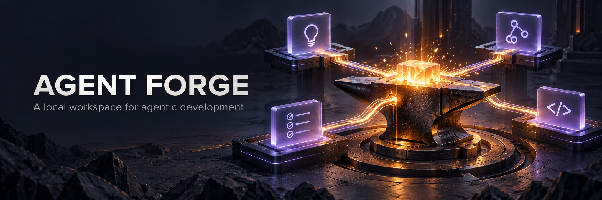
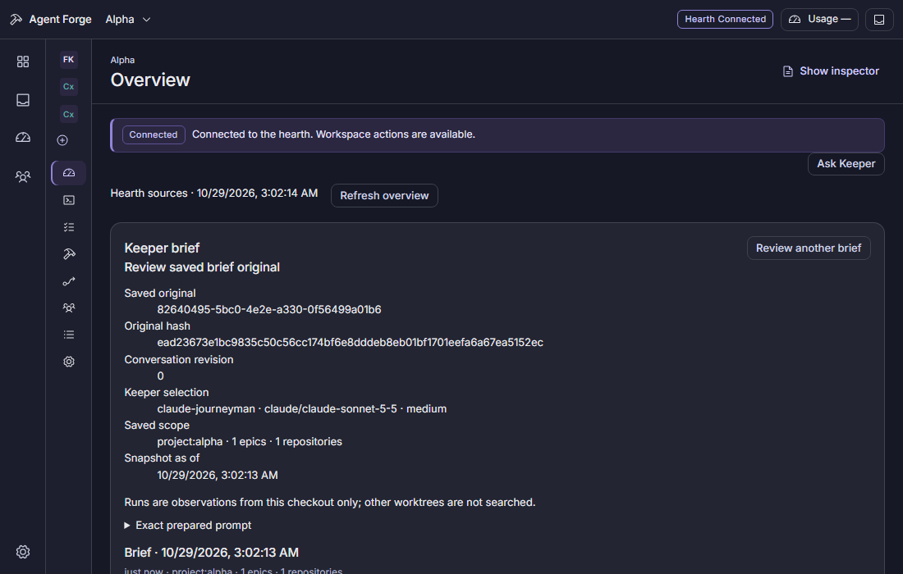
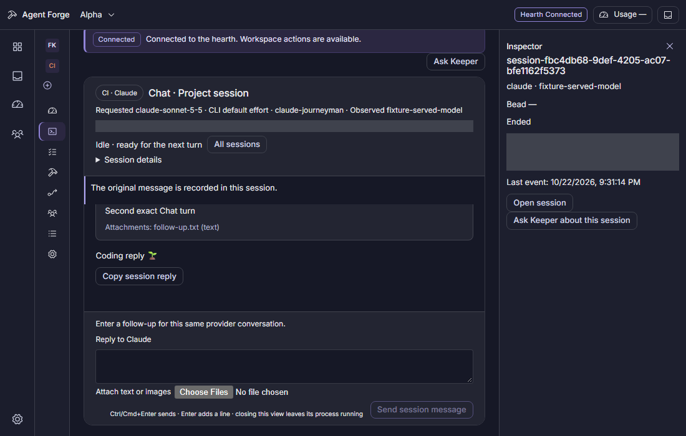

# Agent Forge



**A local workspace for agentic development.** Agent Forge combines a Windows desktop command center with a multi-provider coding harness: organize projects, review agent work, keep task context, and run deliberate coding workflows from one place.

> **Pre-1.0 and in active development.** Features and provider support are still being completed. The Windows desktop build is a staged development executable, not a released installer.

[Harness guide](docs/HARNESS-GUIDE.md) · [Desktop guide](apps/desktop/README.md) · [Council reviews](docs/COUNCIL-REVIEWS.md) · [Agent instructions](CLAUDE.md) · [Contributor rules](AGENTS.md)



## What you can do today

Agent Forge brings project context and agent activity into a local workspace while keeping the harness workflows available from Claude Code and the command line.

- **See your work by project.** Browse project overviews, sessions, Beads issues, Workbench shifts, Runs, and Activity.
- **Keep a durable brief.** Forge Keeper gathers project context and presents proposals for review before actions are taken.
- **Inspect execution setup.** Review smiths, benches, and provider routing.
- **Work with the issue graph.** Inspect Beads and use supported reviewed actions to create or update issues.
- **Review coding sessions.** Start and inspect native Claude and Codex Chats and Tasks, and use Gemini routes where the installed capability and current checks support them.
- **Inspect reported work.** Review available plans, diffs, MCP activity, session outcomes, and provider-reported provenance.
- **Run the harness.** Use scoped workflows, skills, hooks, knowledge files, plans, and optional multi-repository coordination.

Provider readiness and action availability depend on the installed tools and their current capability checks. The app shows the evidence it has; it does not promise that every provider feature is available on every machine.



The banner is a generated illustration; the app screenshots use isolated test fixtures. [Artwork notes](docs/images/agent-forge-banner.md).

The desktop also has navigation for Inbox, Reviews, and Settings. Their full workflows are still in progress. Runs and Activity currently focus on inspection.

## What you need

- **Bun 1.4.2** and **Git** for the harness scripts, dashboard, and desktop build.
- **Claude Code** to use the repository's slash commands, agents, and hooks.
- **Provider CLIs** are installed and authenticated separately through their own setup. Which provider routes are available depends on the installed CLI and its reported capabilities.
- **GitHub CLI (`gh`)** for workflows that open or manage pull requests.
- **Beads (`bd`)** for the live issue graph and its dashboard views. Follow `bd doctor` for local initialization. If `bd` is unavailable, an existing `.beads/issues.jsonl` export can supply snapshot data; without either source, Beads data is unavailable.
- For the desktop, use a Windows x64 machine with the build tools listed below. The harness and dashboard remain usable without building the desktop app.

## Choose a starting point

### Use the harness from your terminal

The harness is the fastest way to use Agent Forge's workflow and agent conventions in a repository.

```powershell
git clone https://github.com/jupes/agent-forge-harness.git
cd agent-forge-harness
bun install --frozen-lockfile
```

Open Claude Code at the repository root so it loads `.claude/`, then start with `/go` for a scoped task or `/forgemaster` for the full research, plan, implement, and ship workflow. `bun run setup` is an optional local configuration wizard; it does not install tools, clone repositories, or initialize Beads.

To coordinate other repositories, add entries to a local `repos/repos.json` based on `repos/repos.json.example`. Clone and sync them with `bun run repo init --human`, and refresh their knowledge with `/sync-knowledge`.

### Run the local dashboard

```powershell
bun run dashboard
```

Open the authenticated launch link printed by the command. It is short-lived and intended for the browser on the same machine. For a fresh link to an already running dashboard, use:

```powershell
bun run dashboard:open
```

The dashboard is a local Vite app connected to the hearth, Agent Forge's local API and event service. It includes Beads views, the Forge run board, and council reviews. Keep the bound address as printed when opening the link.

### Build the Windows desktop app

The desktop currently targets Windows x64. Building it requires Bun **1.4.2**, Rust **1.99.1**, Visual Studio C++ Build Tools with the MSVC toolchain and Windows SDK, and the WebView2 Runtime to run the app.

```powershell
bun install --frozen-lockfile
bun run desktop:build
```

The Release executable and its dashboard and sidecar files are staged in `apps/desktop/build/windows-x64`. Launch `agent-forge-desktop.exe` and select a valid Agent Forge checkout, or pass one explicitly:

```powershell
.\apps\desktop\build\windows-x64\agent-forge-desktop.exe --root "C:\path\to\agent-forge-harness"
```

This build is a runnable Release folder for development, not an installer. The [desktop guide](apps/desktop/README.md) covers startup recovery, local hosting, and the current smoke-test boundaries.

## How the harness works

Agent Forge stores its working conventions alongside the projects it helps:

| Area | Role |
| --- | --- |
| `.claude/` | Agents, slash commands, workflows, hooks, skills, and protocols |
| `knowledge/` | Curated facts about the repositories and their domains |
| `plans/` | Active plan drafts and durable baseline snapshots |
| `.beads/` | Local Beads issue graph, acceptance criteria, and dependencies |
| `repos/` | Optional local configuration for additional repositories |
| `scripts/` | Bun utilities for the hearth, dashboard, worktrees, reviews, and automation |

- **`/review`**, **`/triage`**, and **`/ask`** support code review, task ordering, and repository knowledge lookup.
- Parallel epic work uses isolated Git worktrees and records task dependencies in Beads.

Use `/go` to route small fixes, features, and larger batches to an appropriate workflow. `/forgemaster` guides larger work through research, a Beads-backed plan, implementation checkpoints, and ship preparation; `/forgemaster-mini` is the shorter path for small, clearly scoped changes. The phases can also be started independently when their inputs are ready. See [the harness guide](docs/HARNESS-GUIDE.md) for concepts and customization.

For deliberative reviews, use the local dashboard, CLI, or MCP server. The checked-in council profile uses deterministic fake agents so the review flow can be explored without hosted-provider credentials. See [Council reviews](docs/COUNCIL-REVIEWS.md).

Beads is local-only in this repository. Follow `bd doctor` for setup; do not configure a Dolt remote that publishes the tracker to a public Git remote. Private backups can use `bd export --all -o <private-file>.jsonl` or `bd backup`. See [CLAUDE.md](CLAUDE.md) for the tracking and safety rules.

## Toward 1.0

Planned work includes:

- Folder and Clone onboarding with a reviewed first brief.
- Run launches and distinct Council checkpoint actions, including Approve and Request changes.
- Inbox, command palette, and project and app settings.
- More provider routes, usage-limit continuation, and native terminal handoff.
- Verified Gemini acceptance and clearer capability, permission, and effort reporting; Grok Build is planned.
- Tray notifications, pop-out windows, light and system appearance, and deep links.

Release readiness is assessed separately from these feature plans. OpenRouter is deferred.

## Useful commands

| Command | Purpose |
| --- | --- |
| `bun run setup` | Optional local configuration wizard |
| `bun run typecheck` | TypeScript type check |
| `bun run test` | Run tests under `scripts/` |
| `bun run quality-gate` | Run the hook quality gate |
| `bun run dashboard` | Start the local dashboard and hearth |
| `bun run dashboard:open` | Print a fresh dashboard launch link |
| `bun run desktop:build` | Build the Windows desktop app |
| `bun run worktree` | Manage worker worktrees |
| `bun run council` | Run a council review from the CLI |

## Project map

```text
agent-forge-harness/
├── .claude/       # Workflows, agents, hooks, skills, and protocols
├── .beads/        # Local Beads tracker
├── apps/desktop/  # Windows desktop app and its guide
├── docs/          # Dashboard, guides, and project documentation
├── knowledge/     # Shared and repository-specific knowledge
├── plans/         # Draft plans and committed snapshots
├── repos/         # Optional local multi-repo configuration
└── scripts/       # Bun tooling and local hearth
```

## Contributing

Read [AGENTS.md](AGENTS.md) and [CLAUDE.md](CLAUDE.md) before changing the harness. Use Beads for tracked work, keep local configuration and credentials out of commits, and follow the documented test and review workflow. For desktop-specific setup and boundaries, start with [apps/desktop/README.md](apps/desktop/README.md).

## License

Starting with this revision, Agent Forge Harness is licensed under the
[PolyForm Perimeter License 1.0.1](LICENSE). This source-available license
allows internal business use, including paid work, and allows modifying,
distributing, and selling noncompeting offerings. Providing a product or
service that competes with Agent Forge Harness, including a free substitute,
requires separate permission from [jupes](https://github.com/jupes). The
license terms or their URL, and the [required copyright notice](NOTICE), must
accompany distributed copies. This is source-available software, not
OSI-approved open source.

Versions and copies distributed before this change remain under their original
MIT terms; see the [MIT license at the prior revision](https://github.com/jupes/agent-forge-harness/blob/d08b54cd82adc52561814c4f841e91c2c4f85074/LICENSE).

Several skills under `.claude/skills/` are derived from [mattpocock/skills](https://github.com/mattpocock/skills) (MIT, © Matt Pocock). See [.claude/skills/ATTRIBUTION.md](.claude/skills/ATTRIBUTION.md).

Third-party materials retain their own licenses and attributions. See [NOTICE](NOTICE), [.claude/skills/ATTRIBUTION.md](.claude/skills/ATTRIBUTION.md), and [the Inter font license](docs/fonts/LICENSE-Inter.txt).

The command-center direction of this harness is inspired by Orbit and by Gas Town / Gas City.
