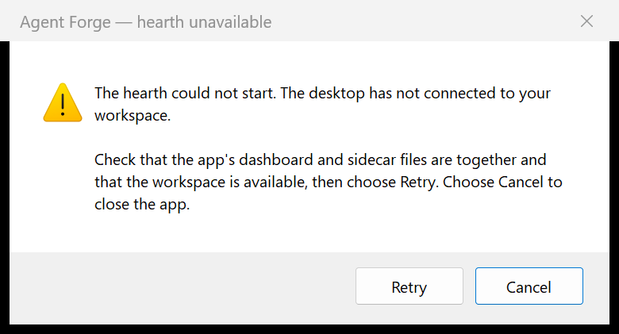
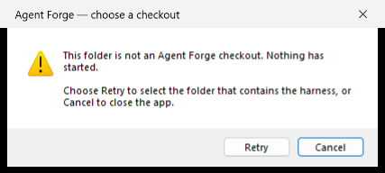
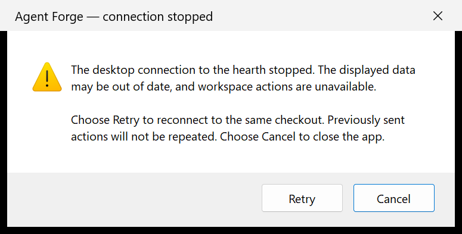
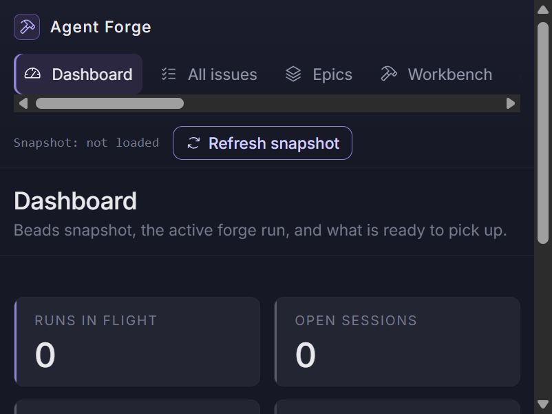
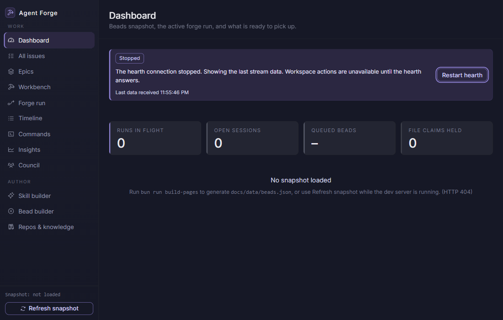
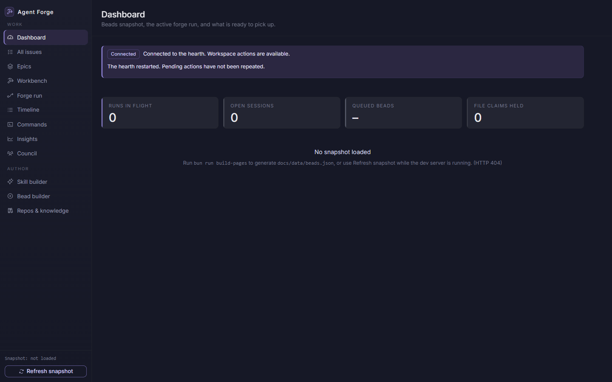
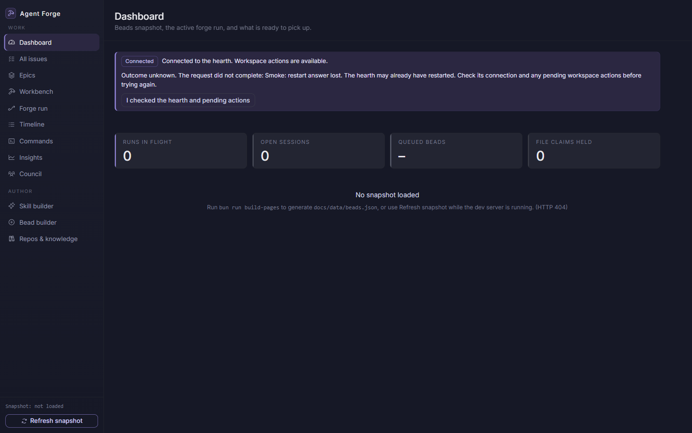
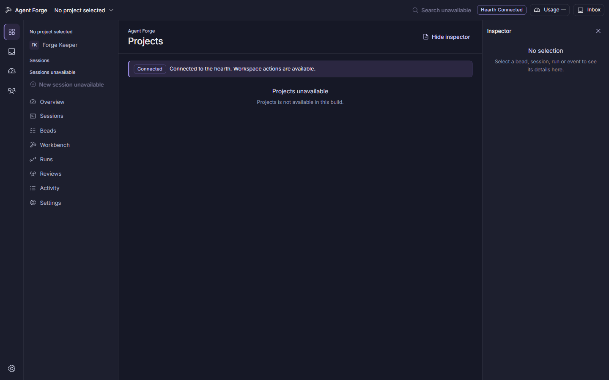
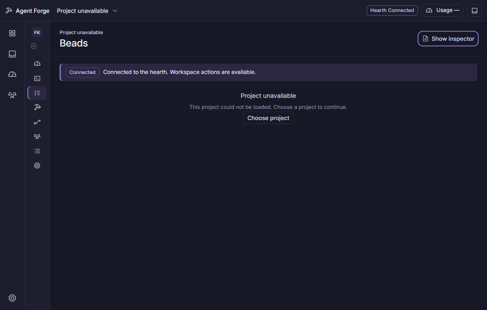

# Windows desktop app

The desktop uses a Tauri 2 window around the Preact desktop frame.
Building requires Bun 1.4.2, Rust 1.99.1 (the version validated for this build), and
Visual Studio C++ Build Tools with the MSVC toolchain and Windows SDK. Running
the staged app requires the WebView2 Runtime and a valid checkout path; it does
not require Bun or Node on the runtime `PATH`. The build compiles the
dashboard, desktop host, and hearth locally; it does not run `build-pages` or
package a Beads snapshot.

From the repository root, run `bun install --frozen-lockfile`, then
`bun run desktop:build`. The Release executable and its dashboard/sidecar files
are staged under `apps/desktop/build/windows-x64`. This is a runnable Release
folder for the first tracer, not an installer. Open the executable normally
to choose an Agent Forge checkout in the native Windows folder picker. A
valid current checkout is used directly. An explicit checkout path is also
supported: `apps/desktop/build/windows-x64/agent-forge-desktop.exe --root <checkout>`.
An explicit invalid path is refused rather than replaced with a different
workspace. Cancelling folder selection exits before starting the host. A
folder missing the harness and Git markers offers Retry to choose again.
The app does not persist the selected path or grant the renderer filesystem
access. If the host cannot start, a native Windows dialog explains the failure
and offers Retry
and Cancel. Cancel is the default; each new launch attempt requires Retry.
The failed host is stopped before the dialog opens. Raw host errors and launch
credentials are never shown in the dialog.





After `bun run desktop:build` has produced the dashboard assets and sidecars,
run the native Rust checks:

```powershell
cargo fmt --manifest-path apps/desktop/src-tauri/Cargo.toml -- --check
cargo test --locked --manifest-path apps/desktop/src-tauri/Cargo.toml
```

`bun run desktop:smoke` starts that Release app against a temporary checkout
with an isolated `AGENT_FORGE_HOME` and unique WebView2 profile, with a bounded
loopback WebView debugger used only by the smoke. It checks the dashboard
folder selection and cancellation, invalid-folder retry, startup Cancel,
repair followed by Retry, the dashboard launch exchange,
packaged asset MIME types, runtime host crashes, Retry and Cancel, a fresh
authorized session after reconnect, disabled stale workspace controls,
blocked retired origins, and clean child shutdown. It does not call a paid
provider or alter the repository's Beads data.

It also opens two windows on one isolated checkout/home and verifies the same
hearth pid survives the former owner's normal close, the last owner's close
stops it, and reopening refreshes the launch session. The hearth has a detached
OS lifetime; its current supervisor's trusted ownership check controls shutdown,
so it can outlive the window that originally launched it.

If the host stops after startup, a native dialog explains that displayed data
may be old and workspace actions are unavailable. The workspace window stays
disabled until recovery completes. Retry reloads the same checkout through a
new launch exchange; it does not replay previously sent actions. Cancel closes
the app. A cleanup-only sidecar invocation uses the failed host's owner UUID
and the existing trusted-lock/health checks to stop its orphaned hearth. It
cannot claim or start a hearth and leaves one now owned by another window alone.
The owner UUID stays in the native startup handshake, outside renderer config.



The picker smoke accepts its displayed temporary folder before and after
adding checkout markers, then checks that the hearth serves that exact folder.
It drives real native dialogs without editing inaccessible OS controls. This
does not automate folder-tree navigation or the full keyboard walkthrough.

The screenshot below records the earlier dashboard transport checkpoint with
isolated fixture data. The current desktop frame is documented below.



Build and test with Bun 1.4.2, matching CI. The host tests verify that renderer
disconnect and host shutdown both close active upstream streams. Bun 1.3.10
does not reliably report renderer disconnects and is not a validated build runtime.

The `.ico` is a neutral, build-only tracer asset created for Windows resource
validation. It is not a final or approved product mark.

## Hearth connection and recovery

`src/connection-state.ts` exports `desktopConnection(status, diagnostics,
compatibility)` for the desktop frame, home and project views. The existing
page's single `appStream()` client now supplies `getDiagnostics()` with the
actual consecutive failure count, retry limit and local time of the last
applied snapshot or new ledger delta. Keepalives and duplicate deltas do not
make retained data look freshly read. Subscribers are notified when retry
diagnostics change even if the status stays `reconnecting`.

The desktop-only `ConnectionBanner` renders Connecting, Connected,
Reconnecting with the actual attempt count, Stopped with Restart hearth, and
Version mismatch. The supplied state galleries guide its banner and last-read
time. Last received stats stay visible during an outage and are labelled as
last received, rather than live. The rest of the dashboard remains the transport
tracer in the earlier connection screenshots. The current desktop frame uses
the same connection controller and does not mount the legacy dashboard.

`connection-recovery.ts` exposes the controller and its subscription, read-only
state, explicit `restart()` and unknown-outcome acknowledgement. It uses the
existing singleton stream. `suspend()` cancels transport/retries while retaining
collections; `resumeFresh()` opens one new stream from a fresh snapshot and
rejects late callbacks and collection reads from the previous connection.

Health reports `apiVersion: 1`, an API compatibility contract independent of
the product release. Missing or malformed versions stay unknown. Desktop
workspace posts are refused in the page while disconnected or unverified and
checked again at the host against the trusted lock's root, pid and compatibility
before forwarding. Reads and the launch/session exchange remain available for
recovery. The ordinary dashboard and static copy retain their existing behavior.

`POST /__agent-forge/desktop/restart` is an operator action table row mounted by
the desktop host. It accepts only an empty object, requires the same origin and
current protected operator token, and records `desktop.hearth.restart` before
the effect. It stops only a hearth whose process identity and supervisor
ownership still match, then starts the configured bundled hearth. Concurrent
reads join that restart, and host shutdown waits for it before owner cleanup.
There is no renderer shell or filesystem command bridge.

Restart returns a fresh same-origin launch link. The page consumes it in place,
refreshes its session and token cache, and resumes reads without reloading or
replaying pending writes. A lost response shows Outcome unknown and holds a
second restart until the operator confirms checking the hearth and pending
actions. Only the existing pre-effect 403 token retry remains automatic.

The native smoke verifies these states in the packaged WebView2 page, two real
hearth restarts, fresh authentication, one resumed stream, retained data time,
unknown-outcome hold, visible keyboard focus, a 24px minimum recovery target,
reduced motion, and 1100x700/1440x900 viewports. It then removes its controlled
failure responses and runs the native host-crash Retry/Cancel checks above.







## Responsive desktop frame

Desktop mode mounts `src/DesktopApp.tsx`; the ordinary dashboard keeps its own
routes, snapshot mode and documents. The frame uses the supplied Projects and
Session pages' shared rail/title/sidebar/inspector layout with the documented
dark Nocturne colors and generated Phosphor glyphs. Native Windows decorations
and window controls remain intact.

The wide frame has a 48px title area, 56px global rail, 224px project sidebar
and optional 300px inspector. At 1100x700 the sidebar narrows to icons and the
inspector collapses. It can be opened explicitly at either size. Closing it
with its button or Escape returns focus to the toggle; automatic collapse
does the same when focus was inside it. Labels remain accessible in the icon
sidebar, long names truncate with their full title, and inspector references
wrap. Reduced motion disables frame animations and transitions. Muted hint
text uses a desktop override with AA contrast against the actual surface.

`src/navigation.ts` is the route contract:

- `DesktopRoute` keeps destination, `projectId` and object `selection` separate.
- `desktopRoute(hash)` parses desktop-only links and rejects malformed paths.
- `desktopHref(route)` builds links from encoded stable ids, never display names.
- `navigateGlobal` preserves the project and selection; `navigateProject` uses
  that same project id, or returns to Projects when none is selected.
- Links are `#/desktop/<global>?project=<id>` or
  `#/desktop/project/<id>/<destination>`. An optional `selectionKind` and
  `selectionId` carry a bead, session, run or event. The inspector's open/closed
  state is local UI state and does not erase the selection.

The global rail targets Projects, Inbox, Providers & usage, Smiths and Settings.
The project sidebar targets Forge Keeper, Overview, Sessions, Beads, Workbench,
Runs, Reviews, Activity and project Settings. This does not settle the deferred
seven/eight-destination discrepancy or create excluded dashboard destinations.

`DesktopFrame` is a pure view. Future project/screen producers pass a verified
`FrameProject` (id, name and project-scoped session rows), main content and
optional inspector content. Rows from a different project id are not shown.
`ProviderMonogram`, `FrameProvider`, `FrameSession` and `FrameSessionStatus`
provide shared provider names, monograms and grouped status glyphs. The header
and banner subscribe to the existing `useDesktopRecovery()` controller; routes
never own the shared stream.

Project persistence and the destination screens belong to later beads. Until
those producers are connected, `DesktopApp` supplies no project and honest
unavailable destinations. It does not invent project records, sessions, usage,
inbox counts or an empty provider allowance. Search and New session are visibly
unavailable. A later project switch must clear a selection from the old project
and resolve the new id through the project source before supplying its rows.

The packaged WebView2 smoke verifies both viewport sizes, no project selected,
long-title truncation (a controlled DOM layout stress fixture), unknown project
and selection references, all five rail destinations, keyboard activation,
inspector Escape/focus return, responsive focus return, text contrast and
unchanged stream/session/origin during navigation. Existing connection recovery
and native crash checks run in that same app and still require clean shutdown.





The [Windows shell review packet](docs/windows-shell-review.md) separates actual
packaged checks from the remaining human checkpoint. Automated results do not
self-certify the HITL review.
