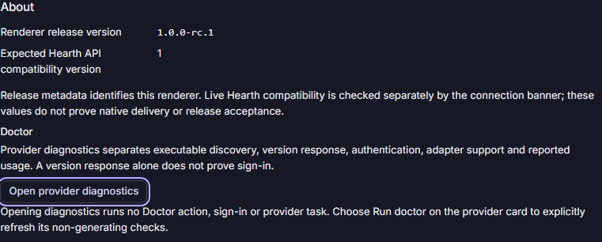

# About and provider diagnostics

Open Settings from the global rail or command palette. About shows the release
version bundled into the renderer and its expected Hearth API compatibility
version. The live connection banner separately verifies the answering Hearth.
These metadata fields do not identify a source commit, qualify a native binary
or certify release acceptance.

Open provider diagnostics navigates inside the same app to Providers & usage,
preserving the selected project and current selection. It uses the existing
shared provider report. Navigation itself sends no Doctor action, signs into no
account and starts no provider task.

Choose Run doctor on a provider card to explicitly refresh the existing audited
non-generating checks. Executable discovery, version response, authentication,
adapter capability and usage remain separate facts. A successful version command
is not proof of sign-in. Unknown usage stays unavailable; local session counts
are not account allowance. See [provider readiness](provider-readiness-contract.md).

This completes the About/doctor entry, not every diagnostic or app Settings
requirement. Updates, integrations and remaining Settings/native/human acceptance
keep their separate open requirements.

Headless browser capture; this does not qualify native delivery or human review.
