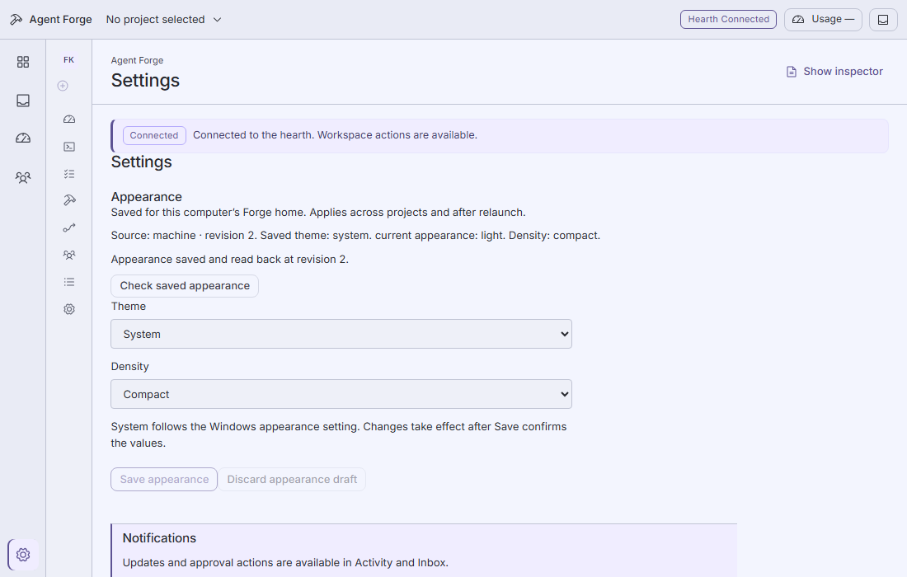

# App appearance

Open **Settings** from the global rail or command palette. Select Dark, Light or
System and Compact or Comfortable density, then choose **Save appearance**.
Dark and Compact are the defaults. System follows the computer’s current color
preference, including changes while Forge is open.

Appearance is stored in the private Forge home on this computer, shared across
projects and restored after relaunch or a changed Hearth origin. Open windows
refresh when brought to the foreground, after relevant metadata changes, or
when **Check saved appearance** is chosen. An unsaved draft is retained when
another window changes the saved settings; review the saved values before saving.
A stale save refuses rather than overwriting the other window’s revision.

**Toggle theme** in the command palette cycles Dark → Light → System → Dark
through the same save/readback owner. It is unavailable while a draft, save,
unverified read or uncertain save needs attention. The action opens Settings so
the confirmed result or recovery message is visible.

If a save’s response is lost or malformed, Forge sends no automatic retry. The
draft remains and further saves are held. **Check saved appearance** can recover
once a newer stored revision fences the earlier compare-and-swap request. A
matching current value alone does not prove that an earlier request succeeded.
If the stored file is invalid or incomplete, Forge retains the last read
appearance and holds saves; it does not silently replace the saved data.

Light mode changes the desktop’s color roles, frame, cards, forms, dialogs,
palette, status text and Beads work map. Provider monograms and names remain
visible cues. Keyboard focus and reduced-motion behavior remain active.

Automated coverage: `scripts/desktop/app-appearance.test.ts`, the guarded operator
API matrix, and `tests/desktop-e2e/app-appearance.spec.ts`. Browser checks use
isolated sources; they do not certify native WebView2 or human Windows acceptance.
Appearance does not complete the other app-wide Settings requirements. OS
notifications, notification master/quiet-hours controls and tray keep-alive
remain deferred to 1.1.
