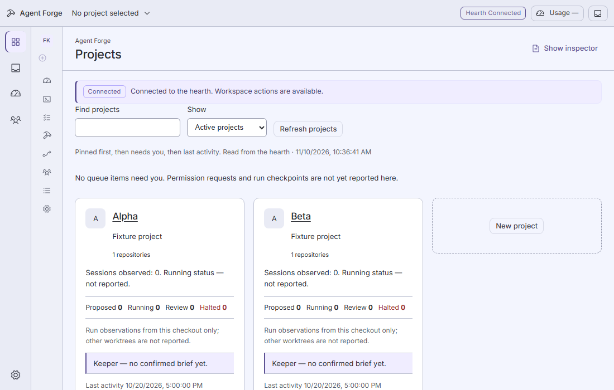
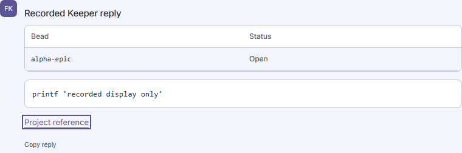
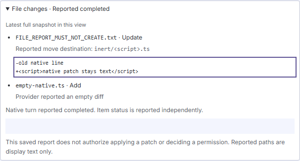

# App appearance

Open **Settings** from the global rail or command palette. Select Dark, Light or
System and Compact or Comfortable density, then choose **Save appearance**.
Dark and Compact are the defaults. System follows the computer’s current color
preference, including changes while Forge is open.

Appearance is stored in the private Forge home on this computer, shared across
projects and restored after relaunch or a changed Hearth origin. Open windows
refresh when brought to the foreground, after relevant metadata changes, or
when **Check saved appearance** is chosen. An unsaved draft is retained when
another window changes the saved settings; review the saved values before saving.
A stale save refuses rather than overwriting the other window’s revision.

**Toggle theme** in the command palette cycles Dark → Light → System → Dark
through the same save/readback owner. It is unavailable while a draft, save,
unverified read or uncertain save needs attention. The action opens Settings so
the confirmed result or recovery message is visible.

If a save’s response is lost or malformed, Forge sends no automatic retry. The
draft remains and further saves are held. **Check saved appearance** can recover
once a newer stored revision fences the earlier compare-and-swap request. A
matching current value alone does not prove that an earlier request succeeded.
If the stored file is invalid or incomplete, Forge retains the last read
appearance and holds saves; it does not silently replace the saved data.

Light mode changes the desktop’s color roles, frame, cards, forms, dialogs,
palette, status text and Beads work map. Provider monograms and names remain
visible cues. Keyboard focus and reduced-motion behavior remain active.

Automated coverage: `scripts/desktop/app-appearance.test.ts`, the guarded operator
API matrix, and `tests/desktop-e2e/app-appearance.spec.ts`. Browser checks use
isolated sources; they do not certify native WebView2 or human Windows acceptance.
Appearance does not complete the other app-wide Settings requirements. OS
notifications, notification master/quiet-hours controls and tray keep-alive
remain deferred to 1.1.

## Supplied Light boards and conversation coverage

The supplied **Light theme · Projects home**, **Light theme · Forge Keeper**
and **Light theme · Session view** boards use a pale canvas and side rail,
white reading surfaces, violet accents, and separate text, muted, status and
focus roles. The desktop maps these through `app-appearance.css`:
`--color-bg` / `--desktop-canvas-surface` for the canvas,
`--color-surface` / `--desktop-card-surface` for cards and reports,
`--color-text` / `--desktop-text` for body text,
`--color-neutral-400` / `--desktop-muted` for supporting text, and
`--color-accent` for focus. Provider monograms keep both names and distinct
colors. The original board images stay outside the repository. Their sample
models, counts and permission buttons are illustrative; permission decisions
remain deferred.

The focused `tests/desktop-e2e/light-conversations.spec.ts` journey extends the
existing list and Settings checks to persisted Light selection, Projects cards,
a saved Keeper reply with a table, code and a link, and an actual owned Codex
Chat showing a saved reply and expanded file-change report with an inert diff.
It uses one explicit Start against the compiled stand-in, never a real provider.
It measures the rendered text against composited backgrounds at 4.5:1, the
offset keyboard focus outline against its surrounding surface at 3:1 with a
2px ring, and the report disclosure at a minimum 24px in each dimension.
The viewport is 1100 × 700 with reduced motion; the page must not overflow
horizontally. Cleanup identifies only the exact new session and original turn;
unknown identity or Stop results fail qualification.

This slice does not qualify separate command or MCP tool states, every loading
or failure state, visual parity of every board element, native WebView2, pop-out
windows or human Windows acceptance. Those requirements remain open under the
light-theme and desktop delivery issues. Product captures below are headless
renderer evidence, separate from the supplied boards.

The inspected product captures use the real renderer with isolated fixtures.
Projects uses the 1100 × 700 viewport. The saved-reply and expanded-report
fragments were captured after those checks with a 1100 × 1200 viewport so the
scroll containers show the full fragment; these images have the fragment's own
dimensions. The report's provenance paragraph is masked. The initial test
attempt failed an early journal read and cleanup read; the corrected exact-turn
readiness case passed in 17.8s, followed by the capture-only revision in 17.2s.
That does not establish the cause of any Windows publication incident.

The test gives its Alpha fixture a fresh private project ID so an earlier saved
Keeper conversation in the same serial suite is preserved. The catalog is
restored only after the exact session settles and its current bytes still match
this case's catalog. The corrected isolated case passed in 17.7s; a focused
two-case run then passed in 19.7s with the recorded Keeper case first and the
Light case second in one shared private home. The older case's screenshot was
preserved and restored. These results qualify fixture isolation, without
establishing a cause for the earlier Windows publication incident.
