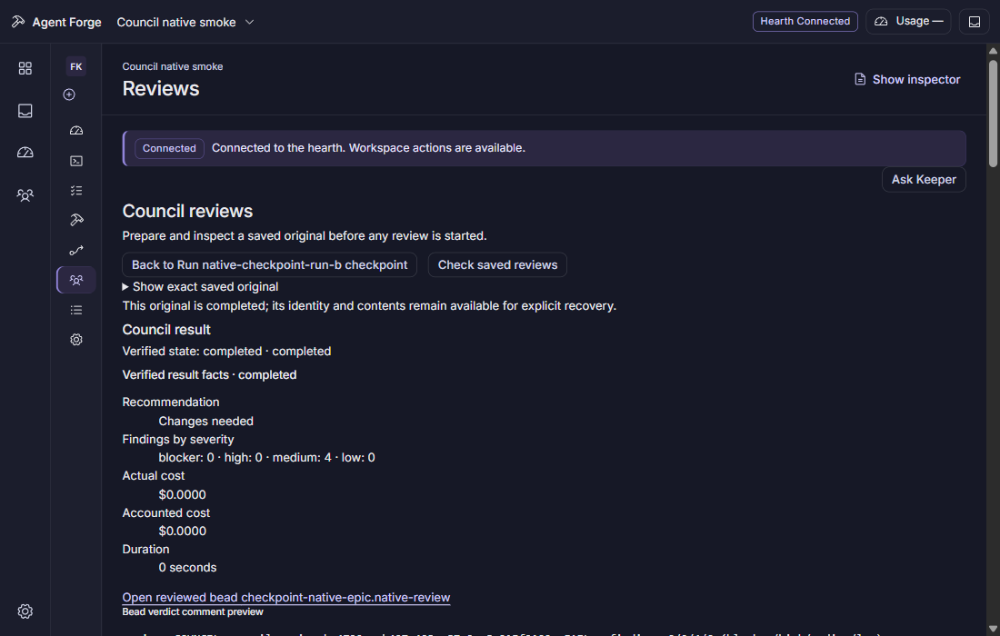
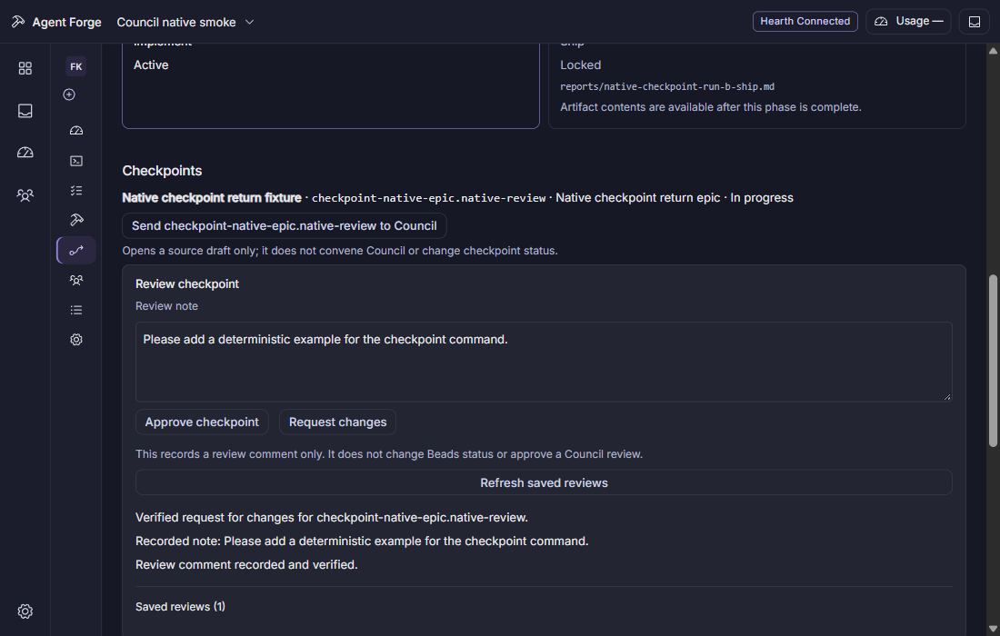

# Return from Council to the exact Run checkpoint

From a verified in-progress Run checkpoint, Send to Council opens a source draft for that exact Bead. It performs no write or Council dispatch. Existing draft options remain; Keep draft retains its existing source and Run return path, while Replace source switches both only when the captured scope and draft revision are still current. A successful manual source edit clears the return path. It lives only in renderer memory and is lost on reload.

Prepare and inspect the protected original, then explicitly Convene. The Council result remains advisory. Back to Run names the originating Run and checkpoint; it opens that exact slug and focuses the note only after the current Run, complete project graph and in-progress checkpoint are verified again. A missing, closed, changed or unavailable target cannot borrow a similarly named Run or stale focus. This navigation makes no human review request.

Approve checkpoint and Request changes remain separate human actions. Request changes needs a nonblank note. They record one verified review comment; the Council verdict is another comment with its own identity. Neither action advances a Run phase or changes Beads status. Unknown write delivery stays held and follows the existing saved-original/readback recovery flow.

## Actual acceptance

The source and fixtures received independent review. Four return-memory cases pass with28 assertions. Two actual browser journeys pass at8f1e649a (22.311s retained owner, all22 owned processes exited, ports free and source clean): dirty Keep/Replace/options/manual edits with no effects; and a completed fake Council verdict followed by exact return focus and one separate human comment. They check full comment bodies and distinct IDs/UUIDs, metadata hashes/lengths without note leakage, keyboard/reduced motion,2px focus and1100x700 layout, unchanged Run files and Bead statuses.

Fresh packaged Windows build5007b719 passes (42.519s, all19 retained processes exited and clean source). The actual WebView2 checkpoint journey passes (22.828s, all26 exited and clean source), including one explicit Council reservation/commit, exact returned selection/focus, one separate keyboard human review, two immutable Run files, distinct comment IDs and bounded readonly ledger evidence. The optional public transcript now fills its panel with Nocturne styling; its layout is checked in the native journey. The captures below were inspected.1100x700 is viewport emulation, not an OS window-geometry or human release-signoff claim.

## Remaining release boundaries

This feature remains stacked on the checkpoint service. Six exact-head CI checks are required before merge. The checkpoint parent’s full Windows run still has unrelated tracked Fork and compiled Shift failures under investigation (cla5.78/79); the retargeted parent CI also exposes a remaining reservation response-capture failure and the known Windows owned-cleanup refusal (cla5.67). No red gate is represented as passed. Broader launch/session/history and human release acceptance remain separate.
