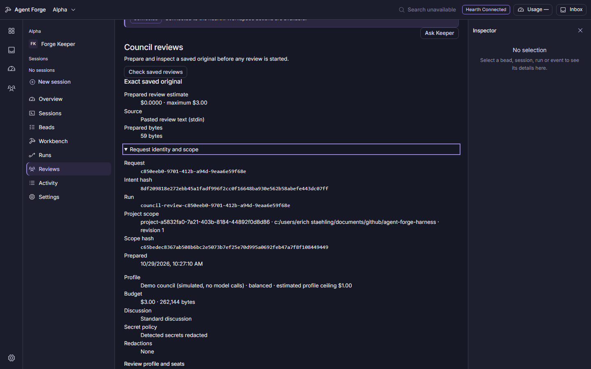
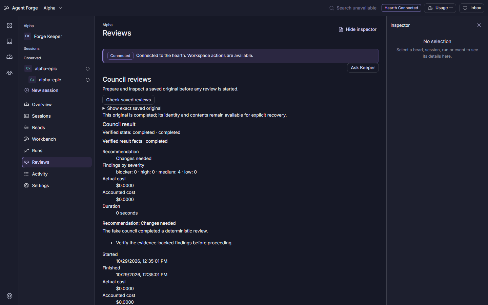
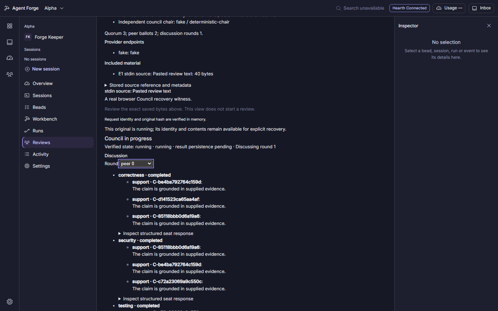
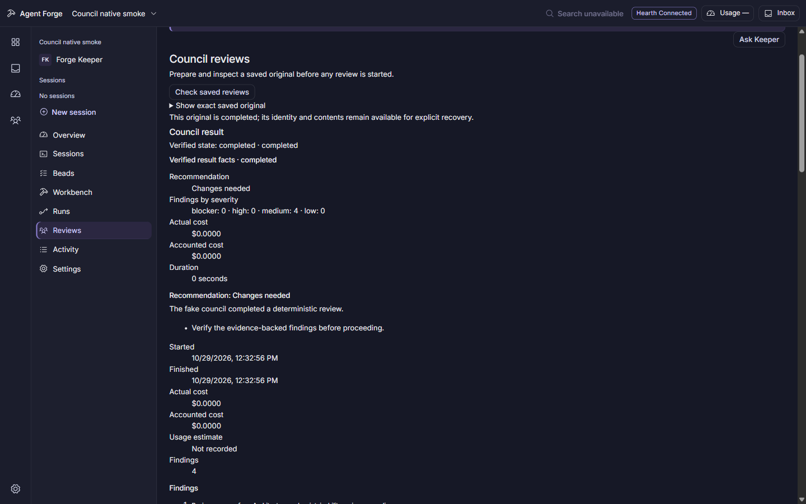
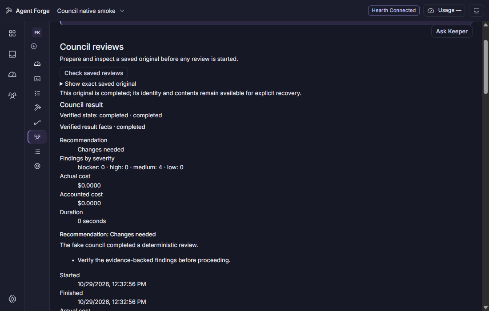

# Project Council reviews

The Reviews destination prepares a private saved original for a project. The
source and profile choices remain a renderer-local draft until **Prepare
original for review** is explicitly selected. Preparation reserves the
canonical request and reads its protected original back; it does not convene a
Council run or call a model provider.

The saved original is shown only in the explicit review view. The page checks
the project and served workspace, request identity, published original schema,
and SHA-256 of the canonical intent before displaying it. The original body is
held in memory for this view; it is not written to browser storage, ordinary
project feeds, or events. Markdown is rendered as safe elements, and control or
format characters are made visible in the presentation without changing the
saved bytes or their identity hash.

If a reserve or retirement response is lost or cannot be verified, the request
stays held. **Check saved reviews** uses the protected project history, then the
protected exact-original read for the active request. An empty list or missing
read alone never proves that a request was not saved. Retirement is available
only for a verified original whose state is still `reserved`.

After reviewing the original, **Convene this exact original** sends its saved
request ID and intent hash once. A verified receipt is followed by a protected
original read and an identity-bound run read. An uncertain result stays held;
the page offers readback and does not submit Convene again. Explicitly opened
active runs refresh through one bounded, abortable read at a time while the
view is open. Stop requests cancellation and reports it only after a matching
saved result confirms the state.

Saved history loads metadata only. Selecting **Read saved original** is the
explicit action that retrieves a stored private original; **Check saved
result** then reads its complete public transcript, findings, discussion,
seat records, evidence, and actual cost fields. Failed and cancelled results
may show partial records but do not receive a fabricated recommendation.

The selected profile view reports configured readiness, seats, model names,
and gateway routing policy from the local Hearth configuration. Readiness is a
local configuration check, not a provider call. The exact saved view shows the
profile, endpoint snapshot, source material, scope, budget, and request hash
that were actually persisted.

Bead details and queue cards can prefill a canonical bead ID in the Council
draft. Session inspection opens a blank summary for the user to write; it never
copies private session frames, commands, tools, or transcript text. Run
inspection can prefill only a verified, completed, present research, plan, or
ship artifact whose recorded path matches the run. A run artifact action does
not complete or change a checkpoint. These actions only update a local draft;
they do not reserve an original, start a review, or contact a provider.

The desktop keeps up to 32 drafts in renderer memory, keyed by the exact project
and served workspace. Each source is limited to 256 KiB. Drafts are cleared on
renderer restart and are not stored in a URL, browser storage, or the network.
Changing a source preserves the profile, cost and byte limits, redaction, and
deep-discussion options. Replacing a different nonempty source requires an
explicit confirmation; a stale confirmation leaves the current draft unchanged.
Capacity and source-size refusals preserve existing drafts.

After an explicit protected result read, saved-review rows retain compact verified
recommendation, severity, recorded cost and duration facts in scoped renderer
memory. Reopening after renderer restart requires another explicit result read.
Completed Bead results link to the exact reviewed Bead and separately read the
posted, refused or unknown verdict-comment outcome. The selected completed Bead result also shows the exact protected comment preview as wrapped plain text; a preview does not assert delivery. Rendering never resends it.

Live reviews show the complete verified profile roster, pending seats, recorded
stage/round progress and completed discussion rounds while a later round is still
active. A stop request remains pending until the saved result confirms cancellation.

The Council consumer is implemented and locally verified. Actual Run checkpoint
actions remain an upstream dependency: the artifact shortcut does not approve or
complete a checkpoint. The broader parent and human/release checkpoints remain
explicitly open.

## Recorded acceptance

Nine browser journeys passed at `29184e23`; the additional live deep-discussion case passed at `125c0262` after correcting a test selector that counted nested evidence items as seats. The latter observes actual peer round 0 during held revision round 1, keyboard-selects the recorded round, checks all five profile seats, and stops the same run once without changing its budget or seat timeouts. The other cases cover all source entry points, deliberate replacement, manual-summary focus, exact Bead verdict/link/history, completed/reloaded results, cancellation, partial failure and uncertain commit recovery. These are inert local providers; no paid calls were used.

The real packaged Windows/WebView2 journey at `9660bde5` passed in 20.139 seconds under the lead's bounded owner. All 29 retained owned processes exited and the source stayed clean. It prepares and hashes a synthetic exact original, convenes once, verifies the completed result, reloads and explicitly reopens the same identity without another POST. The 1440×900 and 1100×700 captures emulate WebView viewport sizes; they do not assert OS window geometry or replace the human acceptance checkpoint.

Focused ownership/draft/status tests, the five live-presentation cases, 24 affected project/verdict route cases and typecheck also passed. The verdict route regression first failed on the missing comment, then proved one exact comment/event and no duplicate on commit replay after the context-ownership comparison was corrected.

The captures show portions of the actual views, rather than every state.

The completed-Bead comment preview and four affected recovery journeys passed together at `fa61ff78`: five actual browser cases, 41.928 seconds under the bounded owner, all 27 retained processes exited, fixture ports free and source clean. The failure case explicitly checks the saved result after an interrupted read; the observer never treats an aborted body as evidence. Typecheck passed in 23.053 seconds. The full Windows unit run at `b7364b6c` recorded 5,684 passes, 40 skips and two home-isolation timeouts; these remain open in `agent-forge-harness-cla5.78`, with cause unknown. No unchanged full-suite retry or passing-quality claim is implied.
