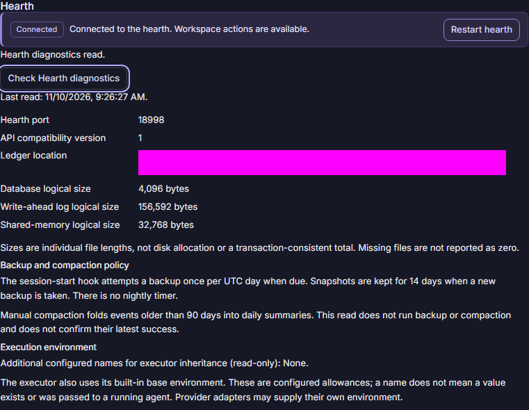
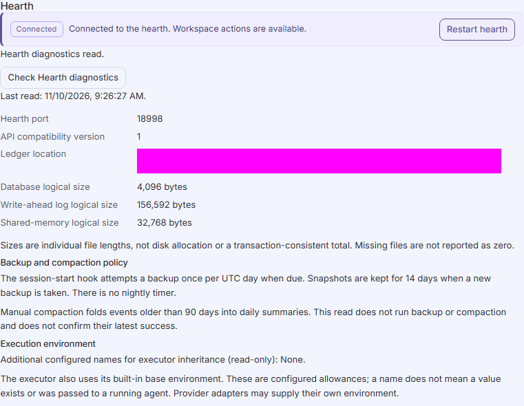

# Hearth and execution environment in Settings

Open Settings from the global rail or command palette. The Hearth section
uses the same connection and recovery owner as the frame. It shows the
Hearth's actual listening port, API compatibility version and configured ledger
location. The desktop front door can use a different port.

Check Hearth diagnostics performs a protected read. The displayed time belongs
to that read. Refresh failures retain the last verified values and label them
as potentially out of date; a successful diagnostics read does not override
a stopped connection, compatibility mismatch or unknown restart outcome.

Database, write-ahead log and shared-memory sizes are individual logical file
lengths. They are not disk allocation or a transaction-consistent total.
Missing means the fixed file was absent at the read; unknown means its metadata
could not be verified as a regular file. Neither is shown as zero. The read
does not open a database, scan folders or perform maintenance.

Each owning Hearth schedules a ledger snapshot at 00:00 UTC while it is
running. Starting or restarting Hearth schedules the next midnight; it does
not immediately back up or backfill missed days. A late wake attempts the
current UTC day once, rather than replaying missed nights. Clock rollback
does not repeat a day already attempted during that Hearth lifetime. The
timer stops before Hearth closes. Closed applications do not run this service.
The existing session-start hook also attempts a backup when due.

Settings shows the next scheduled UTC attempt and the last attempt made by
this Hearth lifetime. No attempt yet is separate from completion. Completed
means the existing snapshot and retention routine returned successfully;
it does not independently verify older backups or restoration. Unconfirmed
means snapshot creation or retention did not confirm completion. Retention
can fail after a snapshot was published, so a snapshot may exist. Inspect the
backup directory before acting; the scheduler makes no automatic retry for
that UTC day. Status resets on restart and is not a durable backup receipt.

Snapshots use SQLite's consistent VACUUM INTO operation and the existing
14-day pruning policy under the bound ledger's backups directory. Multiple
workspace Hearths can share that ledger and each has its own timer; this is
not a global once-per-day guarantee. Existing same-day snapshot replacement
and pruning semantics are unchanged. SQLite and filesystem work are
synchronous and have no promised hard IO deadline. No path or write action
is supplied by the renderer.

Manual compaction folds events older than the existing 90-day policy into
daily summaries. The separate [Ledger compaction](ledger-compaction.md) section
offers an explicit acknowledged action with a backup first and durable
confirmed/unconfirmed outcomes. No compaction scheduler or maintenance policy
editor is provided. Reading diagnostics never takes a backup, compacts events or
confirms an older snapshot's health.

Execution environment displays only additional configured names from the
effective Forge configuration, using the existing loader's secure-layer rules.
The executor also has a built-in base allowlist, and provider adapters may
supply their own environment. A configured name does not prove a value exists
or was inherited by an already running agent. Values, process environment,
other configuration fields and raw loader errors are never returned by this
read. Invalid or oversized names make this section unavailable.

Restart Hearth uses the existing desktop restart route. An unknown outcome
disables further restarts in both Settings and the frame, including after
navigation. Check the Hearth and pending actions before acknowledging that
outcome. Acknowledgement is not proof of successful restart.

## Current Hearth service log

The service log is a protected read of structured observations from the current
Hearth runtime. It includes runtime prepared, listening after lock/token ownership,
and stop began, plus fixed classifications of this runtime's ledger appender
results. A reported stored audit row does not confirm that its action completed.
Stop began does not confirm cleanup. External ledger writers, raw console output,
provider text, paths, environment values and raw errors are not included.

Check Hearth service log reads the latest snapshot. Mounting, reconnecting or an
existing shared stream event can also request a bounded read. These reads do not
append ledger rows, write files or log themselves. No extra stream or persistent
browser history is created. There is no Clear, file selector or export action.

The in-memory log retains at most256 observations and returns the latest128,
bounded to64KiB. Lifetime UUID, start/read times and sequence identify the
observation. Evicted observations are no longer retained; omitted observations
are still in the ring but outside this response. Warnings only filters the returned
rows, so no warnings in this response does not establish an earlier clean history.
The entries region supports keyboard focus and scrolling.

A failed or malformed read retains the selected filter and last verified snapshot,
labelled as potentially out of date. Unsupported or unavailable is separate from
a verified empty response. A new lifetime replaces the old snapshot and shows a
banner; observations from different lifetimes are never combined. Nothing here
proves persistent history, external-writer coverage, completed effects, cleanup,
or native release acceptance.

These features provide read-only diagnostics and bounded service observations,
configured-name inspection, nightly ledger snapshots and explicit manual compaction.
App-wide Settings, native restart settlement and human
Windows release acceptance retain their separate open requirements.

The captures below predate the nightly-backup status and service-log additions.
Headless browser evidence at a 1440 × 1000 viewport; the private fixture path
is masked. These captures do not qualify WebView2 or human Windows acceptance.

