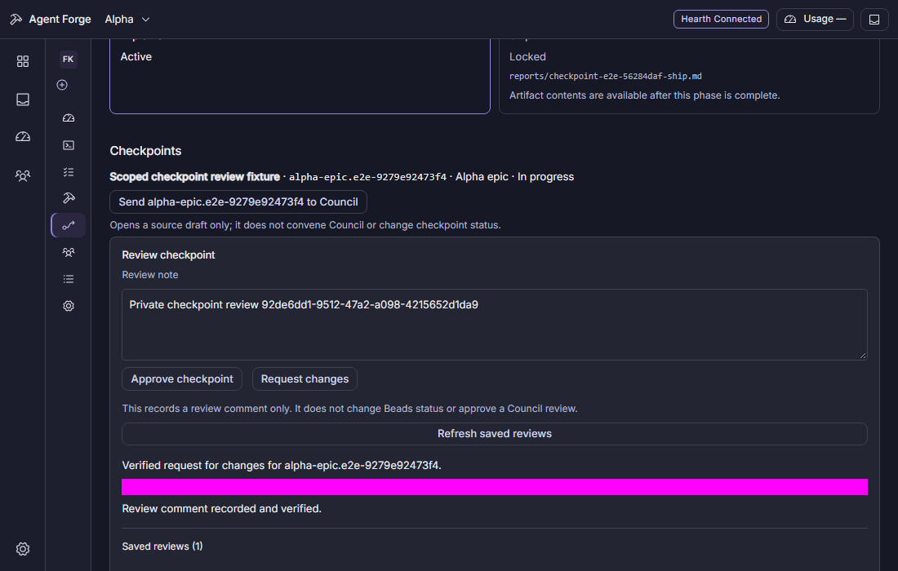
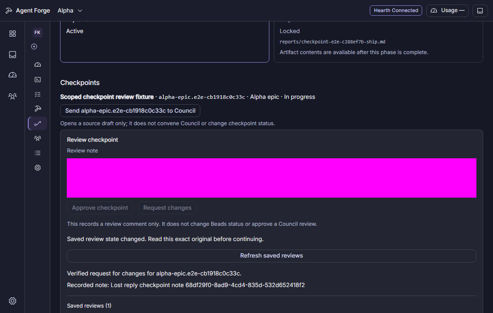
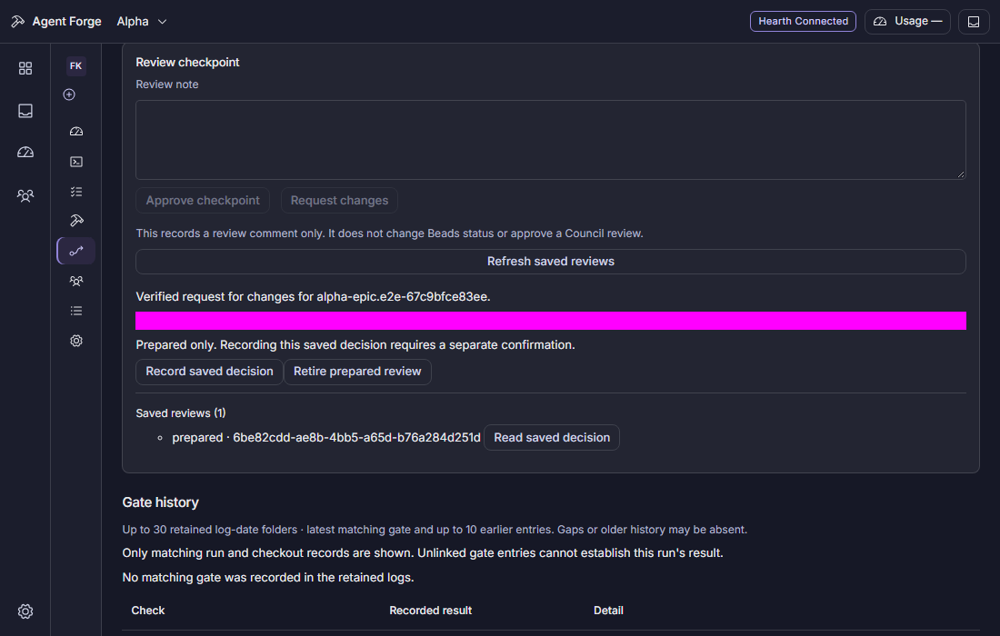

# Human checkpoint reviews

Runs derives checkpoint leaves from the selected Run's recorded Beads epic and a complete current project graph. Each in-progress leaf has a Review checkpoint box. Approve checkpoint and Request changes record a Beads review comment; Request changes requires a note. These actions do not change a Bead status, advance a Run phase, or turn a Council recommendation into human approval.

The common explicit gesture prepares a private immutable original, reads it through the protected operator API, verifies its SHA-256 and captured project/workspace/checkout/Run/epic/Bead/stamp, then commits once while that view still owns the action. The note is kept on refusal or uncertainty. No private review is stored in a URL or browser storage.

After a reload or uncertain response, metadata does not commit anything. Read saved decision verifies the original before Record saved decision is available. Check recorded comment checks an uncertain attempt against the exact full comment, its unique UUID marker and a stable comment ID. A missing, incomplete or mismatching read keeps the attempt held. Retire prepared review can revoke only an original that has not been claimed for dispatch.

The machine-private journal is keyed by canonical workspace and Bead, so another Run or project cannot bypass an unresolved review of the same Bead. It retains immutable originals, receipts and terminal tombstones under an injected cross-process queue lock. It refuses corrupt/linked paths and capacity overflow; it does not evict saved evidence. A dispatch claim surviving a restart is exposed as unknown and is never automatically dispatched again.

## Protected contract

Shared browser-safe codecs and the canonical intent preimage live in `types/project-checkpoint-reviews.ts`. Every route below requires the existing operator boundary. The base is `/projects/:id/runs/:slug/checkpoints/:beadId/reviews` under `/__agent-forge`.

| Method and path | Result |
| --- | --- |
| POST base | Prepare metadata only |
| GET base | Scoped metadata/history without notes or comment bodies |
| GET base/:requestId | Protected metadata, immutable original and receipt |
| POST base/:requestId/commit | Receipt after at most one claimed comment write |
| POST base/:requestId/retire | Prepared-only retirement receipt |
| POST base/:requestId/readback | Receipt from explicit exact comment proof |

Actions use the existing audit-before-effect framework. The outcome event is the existing `bead.transitioned` comment form with a text hash and length, never the note or full body. A ledger failure cannot repeat the comment or undo durable confirmation. Historical original reads check project/workspace routing without requiring the old Run to remain eligible for a new write.

## Verification checkpoint

The lead's serialized Windows gates have passed 17 durable journal cases, eight service cases, five HTTP/scope cases, ten client ownership cases and seven existing Run/artifact regressions across retained source checkpoints. The action inventory ran 11 selected cases with 2,139 assertions and no test failures; its original owner result failed because the invocation incorrectly expected five cases. A separate SHA-bound count correction preserves that distinction without rerunning the unchanged tests.

At `58c307a0`, all three actual browser journeys passed in 25.6 seconds (26.943-second retained owner): keyboard request changes with one exact comment/event; a persisted comment with unknown/lost delivery, reload, explicit original verification and exact readback; and a held prepared original across Run switch/reload with explicit Record. All 22 owned processes exited, fixture ports were free, and source remained clean. Combined typecheck passed in 23.107 seconds, with all four owned processes exited.

The acceptance run first exposed a real self-invalidation race: a checkpoint action's audit event made Runs refresh and unmount the review panel. Runs now watches recorded run/gate/review/verdict state changes instead of generic audit envelopes, while genuine target/owner/active/write-authority fences remain. Metadata alone never promotes a privately read prepared original to unknown; recovery requires the explicit protected read. Test-only corrections keep Playwright Node imports free of Bun SQLite, read actual ledger events through the protected API, create only a bounded metadata fault file in the private fixture home, and distinguish strict read-only version/login probes from any task dispatch.

The 1100x700 captures below were inspected after the actual reduced-motion/keyboard run; private-note fields are masked in some views. They show synthetic fixtures, not real provider or tracker data. Exact-head CI and wider release/native/human acceptance remain separate requirements.

