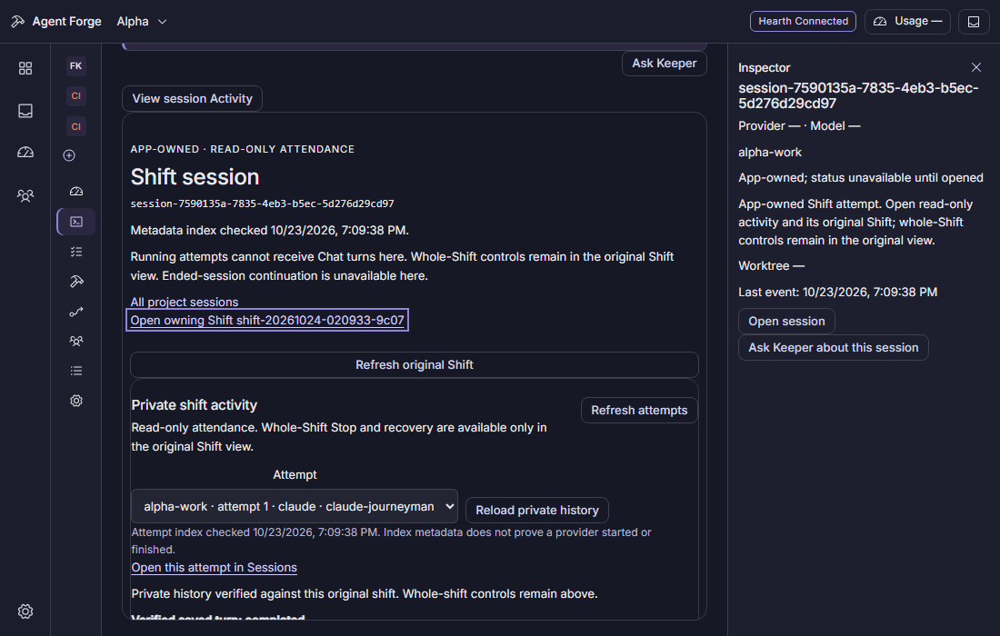

# Session ownership and scoped observations

The desktop reads historical ownership independently of currently available session controls. The protected metadata index uses every provider in the owned registry. A matching registry record wins over a ledger observation and appears once. A failed registry or control read never turns previously verified ownership into an external session. Retained ownership is fenced to the exact project and workspace; asynchronous results also belong to the active view generation.

`GET /projects/:id/session-observations` returns the scoped ledger summaries and a separate ownership result. Owned metadata is `{record, origin}`; the optional typed shift origin is historical provenance, not private-read or process authority. A headless ledger observation does not prove a shift origin. An address that looks like an owned UUID does not prove ownership. The ledger session address is not a provider-native session binding.

`GET /projects/:id/session-observations/:sessionId?after=<cursor>&limit=<1..100>` checks current project membership before reading the exact workspace/session activity. Both routes require the operator token and refuse another served workspace. The index is bounded to 4 MiB, a detail page to 256 KiB, and the renderer retains at most 1,000 activity items/4 MiB. An incomplete or oversized result is never called complete. Failed or malformed subsequent reads keep already verified metadata and show the failure.

The detail contains only recorded start/end metadata, prompt sizes, tool names, durations and explicitly reported exit codes. Hashes do not reveal tool input, filenames, commands, transcript bodies or native identities. Missing facts stay unreported. Parent links require a parent verified in the same current project scope; a missing, ended or later-recorded parent does not hide its child. This view has no composer, resend, provider fallback, Stop, PID control or external resume action.

A session may move between beads and projects. Selection never includes another project's explicitly bead-tagged activity. The server filters those rows after the exact bounded session query, advances the raw cursor across suppressed rows and preserves its `more` flag. An empty visible page can therefore still have more metadata. Untagged rows remain scoped through the verified session membership.

Managed shift sessions remain app-owned even when the ordinary coding service excludes them. Selecting a strictly verified managed Task origin opens the existing dedicated original-Shift reader, then the private attempt index/feed. The complete original request hash, project/workspace, original UUID and Shift ID must match before opening the feed; the exact selected attempt's full origin must also match its fresh index. The server still verifies the immutable original, registry, original user/snapshot, native binding and process/outcome correlation before returning a private page. Metadata selects an address and never grants body or process authority.

Managed attempt links use the existing project Sessions route with `selectionKind=session`, its exact owned session ID and a single `shiftRequestId` UUID. Owning-original links use the project Workbench route with only that `shiftRequestId`. Reload and browser Back/Forward retain those addresses. Missing, mismatched or malformed selections never substitute the newest attempt. A recovered source can explicitly re-read the same selected address. Workbench attendance still supports follow-latest; an explicitly selected Sessions attempt stays pinned. The original Workbench view is the only place offering the existing whole-Shift Stop and Recover controls. Opening, refreshing or navigating private attendance does not start, stop or send a turn. Scoped recorded-parent links remain available independently of a parent's current liveness.

The renderer checks the immutable target and observer address synchronously before projecting a retained receipt or private frame, including the render before selection effects run. Same-identity metadata updates retain the component, observer and keyboard focus. The metadata-index timestamp is shown separately from private-history verification and never proves native ownership or execution.

The ordinary private coding routes remain sealed. No composer, per-attempt Stop, Task-to-Chat conversion, adoption or resume producer is added. Ended managed attempts remain read-only here. External metadata does not provide a verified provider-native binding; external adoption or native continuation needs a separate audited provider-supported handoff.

The source reference is the authoritative design brief at `7e41bba140493849d9f9b2dd3b8ada6773e374a2`, with the supplied nested Observed template `0bbda0cf` and Light Session reading surface `95744122`. The full eleven-page audit found no exact Shift or teammate-plan session board; this implementation does not claim verification against those missing variants. The existing Nocturne tokens, keyboard focus and reduced-motion behavior are shared with the completed owned-session surfaces.

This capture uses only the isolated browser fixture. At `471b6da64dd0816610754ea7a45cba748fba2511`, all four Windows managed-navigation and Cancel cases passed, including direct reload, Back, stable keyboard focus, read-only private attendance, canonical whole-Shift Stop, held/mismatched original refusal and no-effect Cancel. Complete combined suites and packaged Windows verification remain separate gates.
